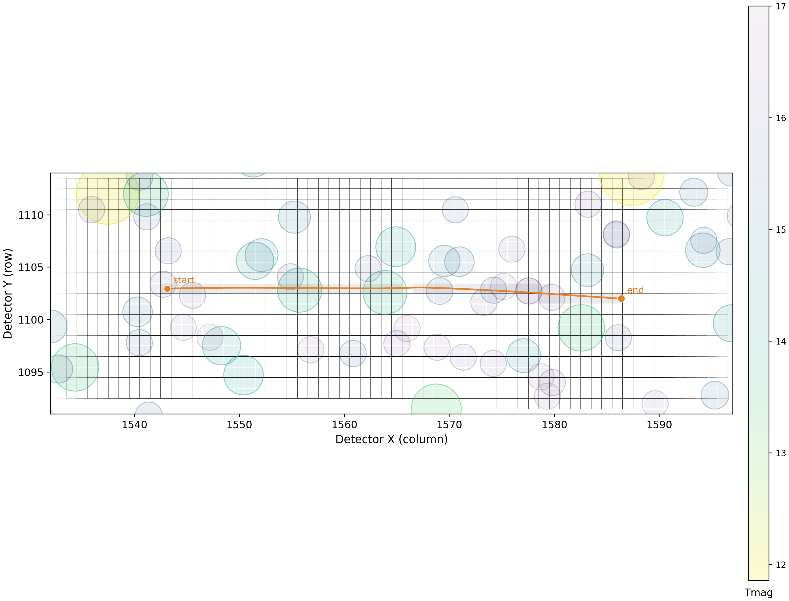
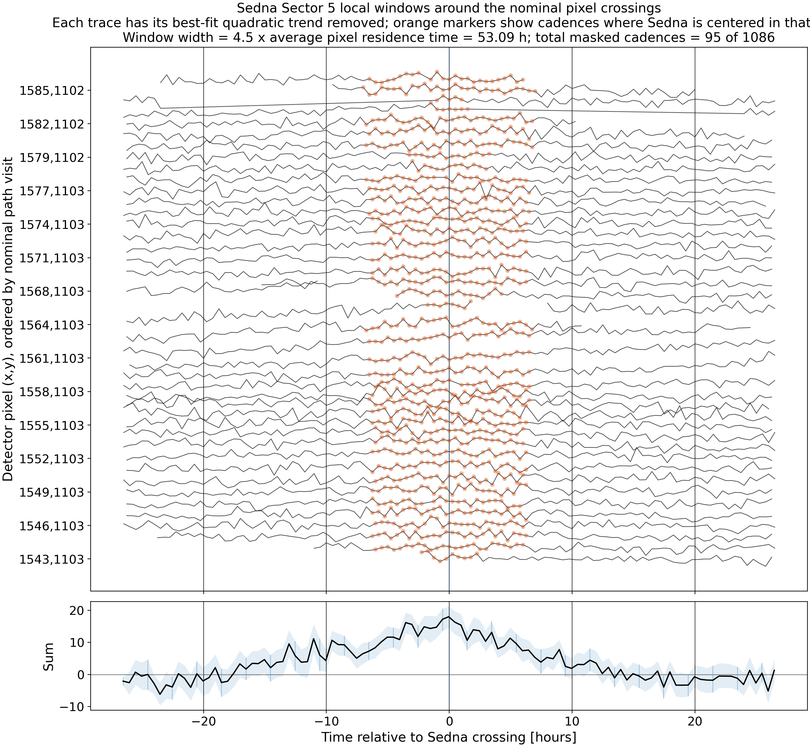
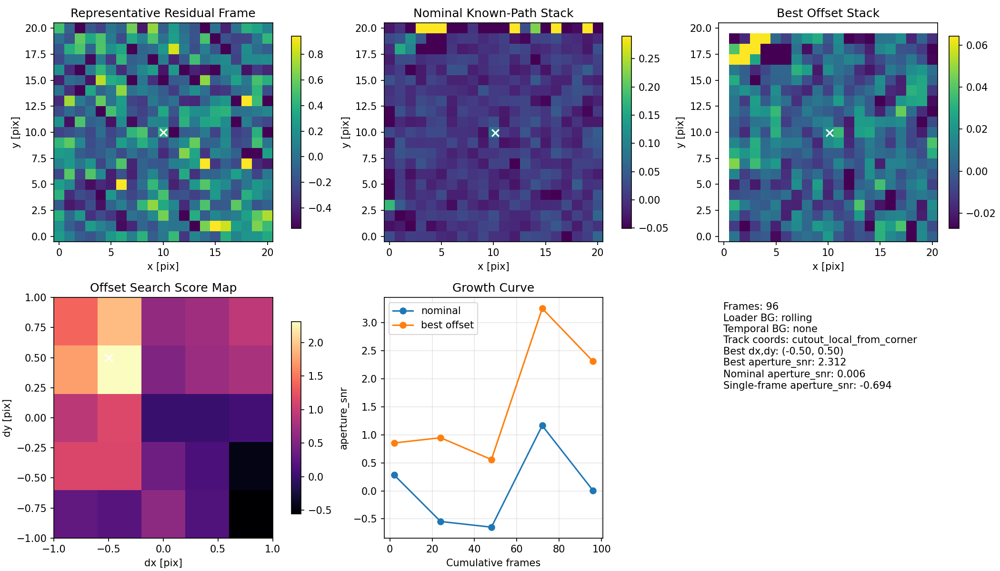
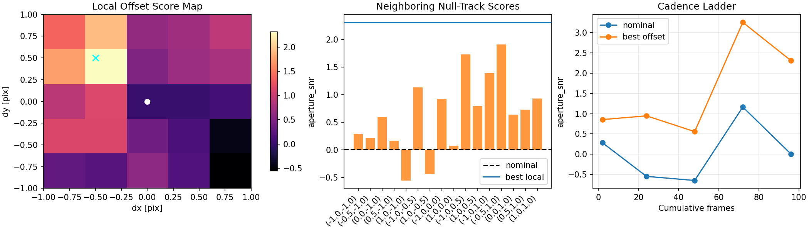
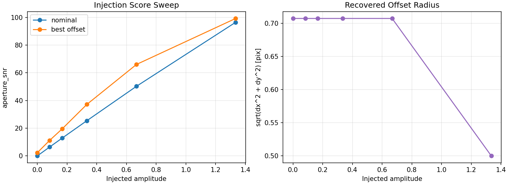
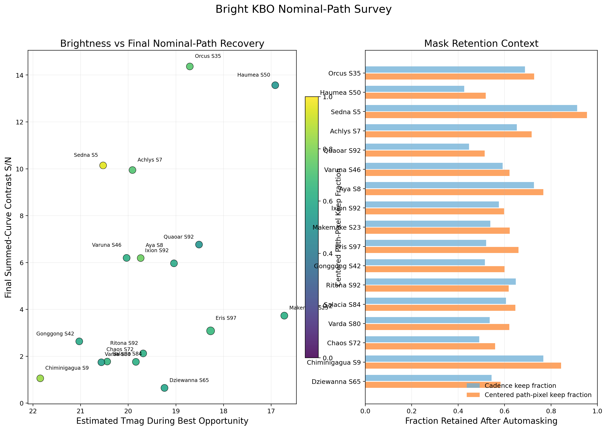

# kbo-tess

Detector-local search tools for faint moving-object recoveries in TESS data.
The project started as a bounded known-path Sedna experiment, then grew into a
small real-data pipeline: ephemeris normalization, moving cutout construction,
geometry checks, known-track stacking, cadence masking, injection calibration,
nearby null controls, and a bright-KBO survey.

The current state is deliberately evidence-first. Sedna has encouraging
path-aligned diagnostics in Sector 5, camera 1, CCD 4, and injected sources are
recovered strongly, but the original bounded 96-cadence shift-stack does not by
itself establish a definitive Sedna detection. The broader survey products show
that the same machinery recovers stronger nominal-path signals for several
other bright KBO opportunities.

## What is here

- A normalized ephemeris CSV interface with explicit TDB timing, target,
  sector, camera, CCD, detector coordinates, and sky-plane metadata.
- Moving TESS cutout bundles stored as local NPZ files with detector-local
  tracks, corners, timing, and metadata.
- Geometry residual checks for barycentric and spacecraft timing conventions.
- Known-path recovery, offset searches, growth curves, injection tests, and
  null-track controls.
- Common-mode/automask diagnostics for full-sector local-window analyses.
- Holman-style image-domain stacking helpers and target-level wrappers.
- A lightweight bright-KBO recovery survey summary in
  [docs/kbo_recoveries.md](docs/kbo_recoveries.md).

## Sedna Arc

The main Sedna real-data thread is Sector 5 / camera 1 / CCD 4. The full-sector
nominal-path diagnostic follows 44 detector pixels over 1086 cadences, masks 95
cadences, detrends each local pixel window, and sums the flux around the known
crossing times. In the compact survey table this produces a Sedna contrast S/N
of 10.14 with an estimated `Tmag ~= 20.53`.

The earlier bounded 96-cadence control study remains useful as a stress test.
It has excellent geometry (`median_detector_residual_px = 0.0027` in the
barycentric bundle), and the best local offset reaches aperture S/N 2.31, but
the exact nominal stack score is near zero. Nearby null controls reach S/N 1.91,
so the bounded stack is suggestive only at the offset-search level.

The same bounded machinery does recover synthetic sources injected along the
known path, which is an important sanity check on the geometry, interpolation,
and score bookkeeping.

## Broader Results

The bright-KBO nominal-path survey ran the same style of detector-local
workflow across multiple outer Solar System bodies. The lightweight tracked
summary includes 17 successful target runs and two failed wrapper runs
(`G!kun||'homdima` and `Máni`). The strongest contrast S/N entries in that
survey are Orcus, Haumea, Sedna, Achlys, Quaoar, Varuna, Aya, and Ixion.

See [docs/kbo_recoveries.md](docs/kbo_recoveries.md) and the CSV files under
[docs/data](docs/data) for the tracked survey table. Full working products
remain under ignored local `outputs/` directories because the cube bundles and
intermediate diagnostics are large.

## Current Interpretation

- The real-data pipeline is now substantially broader than the original Sedna
  rehearsal: it includes target-aware CLIs, automasking, null controls,
  injections, survey summaries, and image-domain stacking experiments.
- Sedna Sector 5 has a coherent full-sector nominal-path local-window feature,
  but the bounded 96-cadence shift-stack is not a standalone detection claim.
- Pluto calibration exposed late-time systematic ramps in the official/simple
  light curves; clipping contaminated cadences made the bounded Pluto known-path
  recovery beat nearby controls more cleanly.
- The most self-consistent bounded Sedna configuration remains
  `barycentric=true` + loader background `rolling` + recovery background `none`.
- The official high-level `tess_asteroids` workflow duplicates in this repo on
  Python 3.12 when run with `KBO_TESS_USE_SYSTEM_HOME=1` and
  `MPLCONFIGDIR=$PWD/.mplconfig`.

Install the baseline dependencies with:

`python3 -m pip install -e .`

For the optional real-data path, install:

`python3 -m pip install -e '.[tess]'`

That path is currently most reliable on Python 3.11-3.12 because upstream
`tess-asteroids` releases do not yet install cleanly on Python 3.13+.

For the bounded official-workflow Pluto benchmark in this repo, the working
environment is currently:

`KBO_TESS_USE_SYSTEM_HOME=1 MPLCONFIGDIR=$PWD/.mplconfig .venv312/bin/python`

Local-file workflow:
- Recovery-ready ephemeris CSV with canonical columns including
  `time_tdb_jd_minus_2457000`, `time_reference`, `x`, `y`, `sector`, `camera`,
  and `ccd`
- Detector-local NPZ cube bundle with `cube`,
  `time_tdb_jd_minus_2457000`, `local_x`, `local_y`, and `metadata_json`

Suggested bounded Sedna workflow:
- Normalize or inventory the detector track:
  `python3 scripts/sedna_inventory.py --target Sedna --sector 5 --camera 1 --ccd 4 --outdir outputs`
- Build the bounded real moving-cutout bundle:
  `python3 scripts/build_sedna_sector5_cube.py --ephem-csv outputs/sedna_sector5_inventory.csv --shape 21 21 --time-start 1438.5008 --time-stop 1440.6008 --barycentric-mode true --bg-method rolling --outdir outputs`
- Check timing and geometry before stacking:
  `python3 scripts/check_sedna_geometry.py --ephem-csv outputs/sedna_sector5_inventory.csv --cube-npz outputs/sedna_sector5_cam1_ccd4_cube_bundle.npz --outdir outputs`
- Run known-path recovery on the local bundle:
  `python3 scripts/recover_sedna_sector5.py --ephem-csv outputs/sedna_sector5_inventory.csv --cube-npz outputs/sedna_sector5_cam1_ccd4_cube_bundle.npz --background-method none --offset-grid-radius 1.0 --offset-grid-step 0.5 --interpolation linear --outdir outputs`
- Compare barycentric timing interpretations on the same subset:
  `python3 scripts/compare_barycentric_modes.py --ephem-csv outputs/sedna_sector5_inventory.csv --outdir outputs/real_control_study`
- Run injection calibration and null-track controls on a chosen bundle:
  `python3 scripts/run_injection_calibration.py --ephem-csv outputs/sedna_sector5_inventory.csv --cube-npz outputs/real_control_study/barycentric/sedna_sector5_cam1_ccd4_barycentric_cube_bundle.npz --background-method none --outdir outputs/real_control_study/injection_barycentric_none`
  `python3 scripts/run_null_track_controls.py --ephem-csv outputs/sedna_sector5_inventory.csv --cube-npz outputs/real_control_study/barycentric/sedna_sector5_cam1_ccd4_barycentric_cube_bundle.npz --background-method none --outdir outputs/real_control_study/null_controls_barycentric_none`

Bounded Pluto calibration workflow:
- Inventory all detector-local Pluto opportunities and pick a bounded primary/backup window:
  `python3 scripts/sedna_inventory.py --target Pluto --all-detectors --window-days 4.0 --outdir outputs/pluto_calibration`
- Build the selected moving-cutout bundle:
  `python3 scripts/build_sedna_sector5_cube.py --target Pluto --sector 92 --camera 2 --ccd 1 --ephem-csv outputs/pluto_calibration/pluto_all_detector_inventory.csv --shape 21 21 --time-start 3826.5008007516153 --time-stop 3828.5008007511497 --barycentric-mode true --bg-method rolling --outdir outputs/pluto_calibration/primary`
- Check geometry and direct moving-aperture photometry:
  `python3 scripts/check_sedna_geometry.py --target Pluto --sector 92 --camera 2 --ccd 1 --ephem-csv outputs/pluto_calibration/pluto_all_detector_inventory.csv --cube-npz outputs/pluto_calibration/primary/pluto_sector92_cam2_ccd1_cube_bundle.npz --outdir outputs/pluto_calibration/primary`
  `python3 scripts/run_moving_aperture_photometry.py --target Pluto --sector 92 --camera 2 --ccd 1 --ephem-csv outputs/pluto_calibration/pluto_all_detector_inventory.csv --cube-npz outputs/pluto_calibration/primary/pluto_sector92_cam2_ccd1_cube_bundle.npz --background-method none --outdir outputs/pluto_calibration/primary`
- Run known-path recovery and null controls:
  `python3 scripts/recover_sedna_sector5.py --target Pluto --sector 92 --camera 2 --ccd 1 --ephem-csv outputs/pluto_calibration/pluto_all_detector_inventory.csv --cube-npz outputs/pluto_calibration/primary/pluto_sector92_cam2_ccd1_cube_bundle.npz --background-method none --offset-grid-radius 1.0 --offset-grid-step 0.5 --interpolation linear --outdir outputs/pluto_calibration/primary/recovery_none`
  `python3 scripts/run_null_track_controls.py --target Pluto --sector 92 --camera 2 --ccd 1 --ephem-csv outputs/pluto_calibration/pluto_all_detector_inventory.csv --cube-npz outputs/pluto_calibration/primary/pluto_sector92_cam2_ccd1_cube_bundle.npz --background-method savgol --interpolation linear --offset-grid-radius 1.0 --offset-grid-step 0.5 --outdir outputs/pluto_calibration/primary/null_controls_savgol`
- Run the transparent flux-ledger plus official-workflow benchmark:
  `KBO_TESS_USE_SYSTEM_HOME=1 MPLCONFIGDIR=$PWD/.mplconfig .venv312/bin/python scripts/run_pluto_flux_ledger_and_tutorial.py`

Latest bounded Pluto follow-up:
- The frozen two-day Pluto bundle is still useful for debugging, but its final
  late-time segment is contaminated by a broad systematics ramp in the official
  and simple-aperture light curves.
- A local clipped rerun with `time_tdb_jd_minus_2457000 <= 3828.30` leaves 777
  of the original 864 cadences and materially improves the `background=none`
  known-path recovery.
- On that clipped bundle, the exact nominal Pluto track is the best local
  solution with score `4.399`, beating the best nearby null control (`3.617`).

Generated `outputs/` are local working products and are not intended to be
committed by default. Small fixtures under `tests/fixtures/` are the preferred
way to preserve lightweight reproducible examples.
