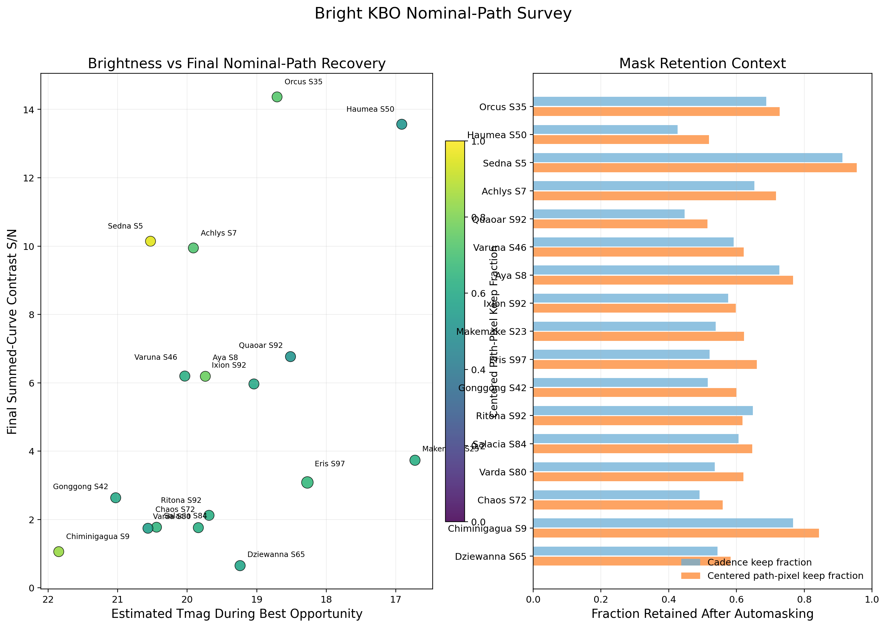

# Bright KBO Recovery Survey

This page records the lightweight public summary from the nominal-path bright
KBO survey run. The full working products live under local `outputs/` and are
ignored by git because they include large cube bundles, masks, intermediate
tables, and diagnostic images.

Data files:

- [Recovery summary CSV](data/bright_kbo_recovery_summary.csv)
- [Run status CSV](data/bright_kbo_recovery_status.csv)

The table below is sorted by the final summed-curve contrast S/N. `Tmag est`
uses the survey's simple `T ~= V - 0.3` approximation, `keep frac` is the
cadence fraction retained after automasking, and `path keep` is the retained
fraction of centered path pixels.

| Target | Sector | Tmag est | Contrast S/N | Keep frac | Path keep | Peak time h | Status |
|---|---:|---:|---:|---:|---:|---:|---|
| Orcus | 35 | 18.71 | 14.37 | 0.69 | 0.73 | -0.28 | success |
| Haumea | 50 | 16.92 | 13.56 | 0.43 | 0.52 | 0.06 | success |
| Sedna | 5 | 20.53 | 10.14 | 0.91 | 0.95 | -0.04 | success |
| Achlys | 7 | 19.91 | 9.95 | 0.65 | 0.72 | 0.02 | success |
| Quaoar | 92 | 18.51 | 6.77 | 0.45 | 0.51 | -0.82 | success |
| Varuna | 46 | 20.03 | 6.20 | 0.59 | 0.62 | -3.05 | success |
| Aya | 8 | 19.74 | 6.19 | 0.73 | 0.77 | 0.32 | success |
| Ixion | 92 | 19.04 | 5.97 | 0.58 | 0.60 | -0.06 | success |
| Makemake | 23 | 16.73 | 3.73 | 0.54 | 0.62 | -2.98 | success |
| Eris | 97 | 18.27 | 3.08 | 0.52 | 0.66 | 1.10 | success |
| Gonggong | 42 | 21.03 | 2.64 | 0.51 | 0.60 | 2.92 | success |
| Ritona | 92 | 19.69 | 2.12 | 0.65 | 0.62 | 3.68 | success |
| Salacia | 84 | 20.44 | 1.77 | 0.61 | 0.65 | 2.71 | success |
| Varda | 80 | 19.84 | 1.76 | 0.54 | 0.62 | -1.06 | success |
| Chaos | 72 | 20.56 | 1.74 | 0.49 | 0.56 | -2.67 | success |
| Chiminigagua | 9 | 21.85 | 1.06 | 0.77 | 0.84 | -0.98 | success |
| Dziewanna | 65 | 19.24 | 0.65 | 0.54 | 0.58 | -0.55 | success |

Two requested objects did not complete in this batch; see the status CSV for
the wrapper exit-code records.
